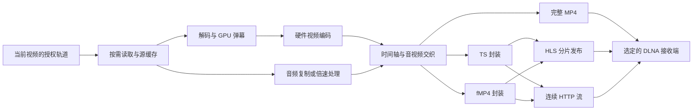

# DLNA 实时弹幕合成方案评估

评估日期：2026-10-26。评估基于 `experiment/lan-continuity-cast`，包含本轮性能改造。本文是实时合成的实施建议，不代表流式输出已经实现或通过电视验收。本轮已获授权进行手机本地测试，结果另记于 `lan-continuity-cast.md`；没有搜索电视或向电视投送内容，当前客厅电视仍不可用于测试。

## 建议结论

面向 DLNA 接收端做可扩展的通用流水线，设备适配按实测能力选择，不绑定某一个电视品牌。保留完整 MP4，优先补齐 HLS + MPEG-TS 和连续 HTTP MPEG-TS；fMP4 提供独立输出适配器，作为后续有实际兼容收益时启用的选项。不要为每个协议各写一套解码、弹幕和编码器。

界面默认「自动」，另提供「边合成边播」「完整准备后播放」。HLS、TS、fMP4 放在设备的高级兼容设置中，只有经过验证的组合才加入自动候选。增加工程量并不能消除接收端的能力限制；支持多少种封装，最终应由覆盖了哪些原本不能正常播放的设备决定。

「实时」需要分开说明：

- **边合成边播**：准备前几个片段后即可播放，后续继续合成，降低首次等待。
- **新增弹幕实时更新**：持续获取新的评论、去重并合入尚未编码的片段。这还需要单独的数据源能力；当前 XML 只获取一次，不能因输出变为流式就宣称新评论实时可见。
- **遥控及时生效**：电视已经缓存的画面不能被手机改写。样式和开关通常在缓冲区播放完后生效；需要立刻改变时应重建会话，并明确可能有短暂重新缓冲。

## 现有代码需要改变的边界

以下定位均相对 Android 工程的 `app/src/main/java/com/Bilibili_Innocent_Lab/xposedmodule/lan/`：

| 代码位置 | 基线行为 | 实时合成需要的变化 |
| --- | --- | --- |
| `CastMedia.prepare` / `CastMediaFetch` | 最多两路并行下载，所有轨道完整落盘后交给 `MediaExtractor` | 保留签名地址、请求头与 CDN 安全校验，增加按需 Range 缓存和有界预取，支持读取尾部索引与跳转 |
| `CastEncoderDrain` | 本轮已改为独立输出线程，AAC 与编码视频按时间交织写入完整 MP4 | 将样本输出提取为可切换封装接口，处理片段边界、时间轴重建与缓冲所有权 |
| `CastVideoEncoder` / `CastDanmakuRenderer` | Surface 解码、GPU 叠字、AVC 编码 | 复用核心；新增输出样本接口、时间轴映射、断点重建、实时吞吐和背压调度 |
| `CastMedia.publish/response` | 只发布完成的 MP4，固定长度、支持字节 Range | 分别支持已完成短片段、原子更新播放清单，以及经过验证的连续流响应 |
| `LanHttpServer` | 所有响应固定 `Content-Length`，媒体与接力共用有界 worker | 保留请求校验；按输出类型正确分帧，长媒体连接不能耗尽接力/控制通道工作线程 |
| `DlnaDevice` / `DlnaClient` | 只保存 AVTransport 与 RenderingControl；SOAP helper 固定加入 `InstanceID=0` | 增加 ConnectionManager 与 SCPD 能力解析；`GetProtocolInfo` 没有 `InstanceID`，需要按动作签名生成参数 |
| `LanRuntime.cast` | 全部准备结束后才 `SetAVTransportURI` / `Play` | 首批媒体就绪后启动接收端；持续维护生产、播放、失败回退和清理状态 |

不能提前暴露现有 `MediaMuxer` 正在写的 MP4。Android 官方要求调用 `stop()` 后才能使用输出文件；将旧接口返回时机前移不是受支持的流式实现。[MediaMuxer](https://developer.android.com/reference/android/media/MediaMuxer)

## 输出方案与必要性

| 方案 | 建议定位 | 优点与明确边界 |
| --- | --- | --- |
| 完整 MP4 | 必须保留，兼容回退与用户手动选择 | 本项目已有客厅电视成功记录。等待完整准备，但文件总长度、完整时间轴与字节 Range 容易正确实现；并非所有编码规格都已验证 |
| HLS + MPEG-TS | 首选流式候选，先做闭环 | 短片段是已完成文件，容易重试、限额和观察缓冲；电视必须能把 HLS 清单作为 DLNA 媒体播放。DLNA 标签本身不能证明这项能力 |
| 连续 HTTP MPEG-TS | 有必要的第二条兼容路线 | 与 HLS 共用 TS 封装器，服务不接受清单但能读取连续 TS 的接收端。总时长、暂停后恢复、断连重连和跳转各需独立验证；通常要由手机重建目标时间附近的流 |
| HLS + fMP4 | 可插拔候选，有设备收益后加入自动选择 | 复用清单和分片缓存层，适配实测接受 fMP4 的接收端。需要初始化段；支持普通 MP4 不等于支持该组合 |
| 连续 HTTP fMP4 | 仅做有证据的设备适配，不默认全开 | 输出可以逐片形成，但接收端仍可能等待文件末尾或不接受未知长度；不能根据 MIME 相同推断可播、可 seek |
| WebVTT / ASS 等旁挂文本 | 可为普通字幕另做能力适配，不作为滚动弹幕通用方案 | HLS 的 WebVTT 定义用于字幕。当前需求的连续移动、描边、彩色、多轨密度和样式一致性仍由手机烧入视频保障；没有接收端渲染契约就不能承诺旁挂文本达到相同效果 |
| LL-HLS、DASH、WebRTC、RTSP | 暂不作为通用 DLNA 首轮目标 | 当前没有这些接收能力的实测证据。点播弹幕首先需要稳定的几秒缓冲和完整遥控；增添协议名本身不改善已知目标电视 |

HLS 的 TS 段需要对应节目表；fMP4 段需要初始化映射。两者是不同封装适配，不必是两套合成算法。清单只能列出已可完整下载的片段，不能先列未来片段再让请求等待编码。[RFC 8216 §3、§6.2.1](https://www.rfc-editor.org/rfc/rfc8216.html)

连续流需要规范的 HTTP 消息边界：未知长度时使用接收端验证过的 chunked 或连接关闭定界，不伪造巨大 `Content-Length`，不同时发送 `Content-Length` 与 `Transfer-Encoding`。连续流和固定片段应使用不同响应类型，而不是削弱现有请求解析规则。[RFC 9112 §6](https://www.rfc-editor.org/rfc/rfc9112.html)

当前用户明确使用 DLNA，因此 Google Cast、AirPlay 等属于另外的接收端适配任务。架构可以预留统一控制接口，但没有必要为了这次实时合成把所有发现与遥控协议一并实现。对拥有相关接收端的用户，再提供对应适配才有可验证的收益。

## 共用架构

源读取建议基于现有下载校验增加随机读取缓存，优先获取初始化信息和播放位置附近的数据，再顺序预取。Android `MediaDataSource.readAt` 提供按偏移读取接口；未下载区域应按需获取，不能把临时缺数据返回为 EOF，也不能让取消后一直阻塞。[MediaDataSource](https://developer.android.com/reference/android/media/MediaDataSource)

输出接口应表示轨道格式、带时间戳的压缩样本、片段完成及终止，明确 buffer 所有权。允许复用一套编码样本做不同封装；同一手机无需为了支持多个协议而同时运行多个硬件编码器。

fMP4 可评估 AndroidX Media3 的独立 muxer 模块，而非引入整套播放器或替换现有 GL 链路。官方当前接口支持 `WritableByteChannel`；目标分片时长受同步帧间隔约束，并非精确计时器。[FragmentedMp4Muxer.Builder](https://developer.android.com/reference/androidx/media3/muxer/FragmentedMp4Muxer.Builder)

该库要求调用者交织各轨样本，当前文档不支持乱序 B 帧；其禁用样本复制时会接管 buffer，不能随后马上释放/复用 MediaCodec 缓冲而不处理所有权。本项目当前没有 Media3 依赖，实施时应固定版本并核对对应源码，不能直接按滚动文档 API 升级工程。[FragmentedMp4Muxer](https://developer.android.com/reference/androidx/media3/muxer/FragmentedMp4Muxer)

## 设备能力与用户选择

能力来源应分层保存：设备声明、实际尝试、播放验证。`GetProtocolInfo` 的 `Sink` 给出接收端协议和内容格式候选；通配符、粗略的 `video/mp4` 和 SOAP 成功都不能替代画面验证。[ConnectionManager §2.4.1、§3](https://upnp.org/specs/av/UPnP-av-ConnectionManager-v1-Service.pdf)

建议按 UDN、设备描述/固件线索和输出规格保存能力记录，固件或规格变化后重新确认。只在用户已经发起当前视频投屏时试播该视频，绝不自动推送测试素材或其他视频。验证参考接收端请求、运输状态和进度变化；这些只能判断传输是否推进，声音与画面仍需实测验收。

自动模式按以下规则选择：

1. 优先使用这台接收端、当前编码规格已验证的流式输出。
2. 未验证时结合声明选择流式候选，给出有界等待，失败后按已知兼容路线回退；每次回退保留当前视频和目标进度。
3. 避免一个坏网络触发所有封装轮流重试；区分 CDN、编码、HTTP 传输和电视解码失败。
4. 用户选择「边合成边播」时，如只能完整准备，应明确提示实际行为，不静默伪装为实时。
5. 高级设置保留「自动 / HLS-TS / HTTP-TS / 已验证 fMP4」，显示上次结果和重置能力记录。普通首页无需展示所有封装术语。

AVTransport 只保证正常 1 倍速，其他倍速由声明的 `TransportPlaySpeed` 值决定；按时间跳转也要核对 `A_ARG_TYPE_SeekMode`，不能默认任何电视接受 `REL_TIME`。当前代码直接发送任意速度和 `REL_TIME`，应逐步改为能力驱动，并保留手机重建流作为可用回退。[AVTransport §2.2.9、§2.2.31、§2.4.10、§2.4.13](https://upnp.org/specs/av/UPnP-av-AVTransport-v3-Service-20101231.pdf)

## 进度、倍速、样式与缓存

**时间轴统一。** 每个投屏会话保存源视频绝对时间、输出流时间、速度、样式版本及会话代号。手机进度条显示源视频总进度；接收端可能只看到当前窗口的时间轴，需要换算，不能直接把电视局部 `RelTime` 当成全片进度。

**跳转。** 已缓存区域优先重用同样式、同速度片段；目标未合成时取消旧预取，从目标前的关键帧解码并丢弃目标前画面，建立新输出会话。可用的电视原生 seek 只覆盖实际可寻址媒体，不能跳进尚未存在的片段。换源时隔离旧请求与新时间轴，避免旧音频、旧弹幕或旧分 P 混入。

**倍速。** 优先使用实测支持且音频行为正确的电视倍速。手机侧倍速回退需要同步改变视频呈现时间，并对音频做保音调处理及重新编码；不能只改视频 PTS 或只在 SOAP 里发送分数就声称完整支持。原生倍速还会提高媒体消耗速度，因此缓冲调度必须考虑实际消费速率。

**样式和弹幕开关。** 新样式只影响尚未编码的片段，界面显示预计缓冲延迟；「立即应用」建立新会话并从当前源进度重新起播。分片 URL 包含随机会话代号与样式版本，已发布片段不可原地替换为不同内容，避免缓存返回旧画面。

**新增弹幕。** 独立定义数据获取周期、服务器时间对应、稳定标识去重、迟到处理和内存上限。先验证宿主现有合法数据通道，不能把历史 XML 的周期性全量刷新默认称为低延迟推送。对于已经烧入且被电视缓存的时间段，新到弹幕无法补回。

**长视频。** 默认采用有界输出窗口，按秒数及字节数双重限额；保留播放附近片段和正在传输的文件，暂停时停止无限向前合成。HLS 的 EVENT 清单只能追加，若要删除旧段应使用滑动窗口，并遵守删除后的保留期限；清单更新必须原子完成。采用本地更长缓存可以加快回跳，但不能假装电视拥有完整可 seek 的时间轴。[RFC 8216 §4.3.3.5、§6.2](https://www.rfc-editor.org/rfc/rfc8216.html)

**长暂停。** HLS 发布节奏和后台编码速度分开管理，不能把 live 清单冻结任意时长仍承诺所有电视会等。设计一个有界暂停保留期：短暂停尽量保留现有会话，超过预算后保存源进度并释放生产资源，恢复时建立新会话。需要接受此时可能重新缓冲；是否能一直维持原 URI 暂停恢复由接收端验收决定。连续 HTTP 流也要处理电视在暂停时继续读取、停止读取或关闭连接三种情况。

**持续运行。** 合成、HTTP 服务与宿主 Activity 的生命周期分离，停止、断网和用户取消均能及时关闭 codec、socket 与缓存。正式实现需要核对宿主 Hook 与模块进程的服务归属、声明权限和安全 IPC；不能仅创建后台线程就保证熄屏继续。Android 的 `mediaProcessing` 前台服务也有运行时限，不能当成无限后台许可证。[Foreground service types](https://developer.android.com/develop/background-work/services/fgs/service-types)

## 性能与清晰度判据

流式主要减少首次等待，并不自动减少整片编码计算量。稳定播放要求持续合成速度高于消费速度且留有温升余量；2 倍速播放时消费速率也变为 2 倍。缓冲耗尽时明确重新缓冲、增大缓冲或切换完整准备，不能通过偷偷降分辨率、丢帧、缩减弹幕密度来冒充优化。

首轮可从约 2 秒目标片段、6–12 秒起播缓冲试验，再根据接收端的真实起播和缓存行为调整；这是测试起点，不是现有性能或秒开承诺。编码器请求关键帧后应检查实际关键帧边界，不能简单按墙钟切开一个 GOP。

当前输出尺寸直接取源轨道，没有固定 720p 缩放；过去实测的 1280×532 是源宽高，无法仅凭该数字判断合成器降清晰度。本轮已将字号从仅按高度计算改为适配 16:9 大屏的视觉比例，1280×532 默认字号由约 18.5 像素增至 25 像素，并对固定纵向基线作像素对齐；横向保留亚像素滚动。文字纹理采样、最终 AVC 压缩、电视放大和源分辨率仍须分别观察。容器从 MP4 换成 TS/fMP4 本身不会创造更多图像细节。清晰度与性能比较需固定源轨道、字号、密度、帧率和最终显示尺寸，另列用户主动选择更高画质时的成本。

本轮 Mi 10 实测：固定 120 秒、1280×532、30 fps 素材及旧字号，旧 CPU 逐帧位图版本为 62.947 秒，本轮三阶段 GPU 管线为 14.475 秒（约 4.35 倍；包含前一轮图集优化的累计收益）。默认新字号的完整 952 秒视频使用公开可获取的 854×356 轨道，包含下载的准备耗时 99.163 秒，其中两轨下载 5.247 秒；全部 28,563 个视频样本与 44,628 个音频样本保留。1080p 的 15 秒测试图合成用时 3.990 秒。它们证明手机有继续试验流式合成的吞吐基础，不能替代电视流式兼容性、持续高分辨率温升和起播缓冲验收，亦不能把 480p 的整片结果当作旧 720p 场景的耗时承诺。详细条件及记录见 [本轮实测](lan-continuity-cast.md#2026-10-26-手机性能与清晰度改造)。

## 实施和验收顺序

1. **共用管线与模拟接收端**：完成按需读取、样本交织、输出接口、取消与时间轴；在本机模拟慢读、断连、Range、seek、跨样式会话，确认不会占满接力通道或泄漏签名媒体地址。
2. **HLS-TS 与连续 TS**：共用 TS writer，分别验证本地解析、音画同步、关键帧起始、长暂停与回跳。TS writer 的 PAT/PMT、PES、PTS/DTS/PCR、连续计数和音频封装需要独立边界测试，不能把任意编码数据加包头就算完成。
3. **手机稳定吞吐**：固定本地媒体测首片耗时、持续合成倍速、峰值内存、温升后吞吐、暂停/恢复与取消。再测真实网络冷启动，分开报告下载和编码时间。手机播放验证只证明手机解码器接受产物。
4. **电视释放后验收**：只用用户指定视频，分别验证 HLS-TS、连续 TS、完整 MP4，记录实际声画、起播、缓存、暂停、进度、样式、倍速、长片与重连。对电视不支持的分支报告具体拒绝点，不把 SOAP 接受当成成功。
5. **按覆盖收益启用 fMP4**：用明确接收端验证 HLS-fMP4/连续 fMP4；有真实增益再加入默认候选。未测试的路径保持实验标记。后续需要其他投屏协议时复用同一媒体管线与能力记录模型。

上述路线建议支持所有有独立兼容价值的输出方式，同时将用户操作压缩到少量明确的播放模式。当前尚未实现实时分片、手机侧音频倍速和新增弹幕订阅，也没有本轮电视协议兼容性结果。
